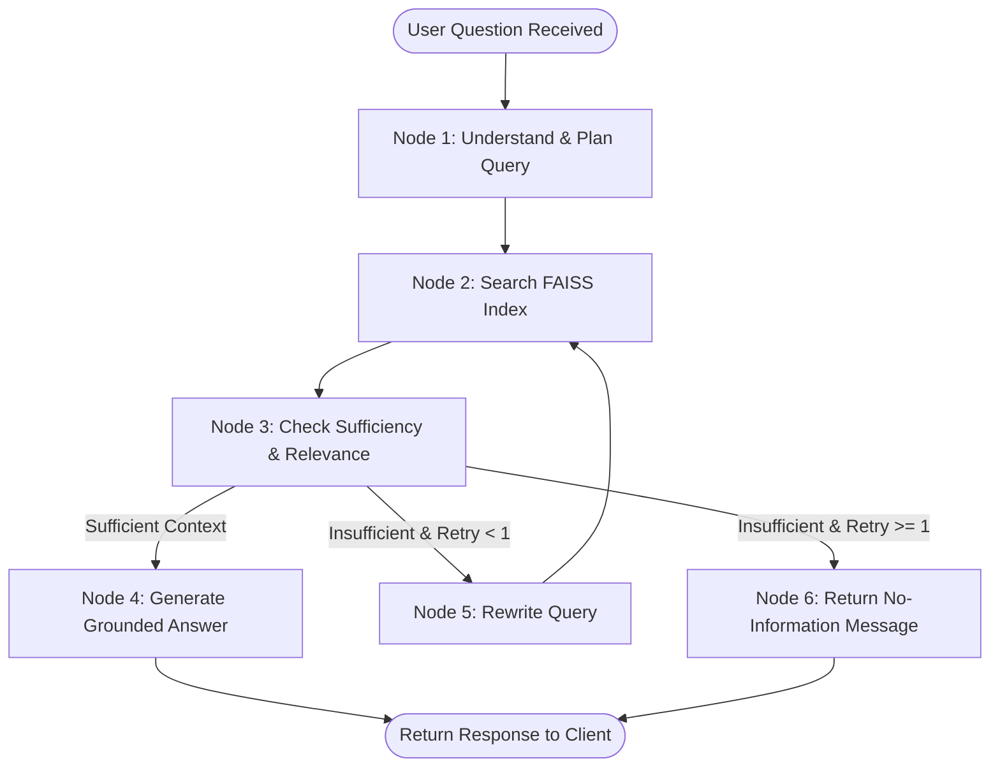

# System Architecture Document
## E-Commerce Application & Agentic RAG Product Knowledge Assistant

---

### 1. High-Level Architecture Overview

The system maintains a clean 3-tier architecture with an **in-process Agentic RAG engine**. It does not introduce external microservices, standalone vector servers, or separate message brokers. Everything runs inside the existing ReactJS frontend and FastAPI backend.

```text
┌─────────────────────────────────────────────────────────────┐
│                      ReactJS Frontend                       │
│  (Existing Shop Pages + Floating Product Assistant Drawer)  │
└──────────────────────────────┬──────────────────────────────┘
                               │  HTTPS / JSON API Requests
                               │  (Bearer JWT Token + Context)
                               ▼
┌─────────────────────────────────────────────────────────────┐
│                    FastAPI Python Backend                   │
│                                                             │
│  ┌────────────────────────┐      ┌───────────────────────┐  │
│  │ Existing E-Com Routes  │      │  Agentic RAG Engine   │  │
│  │ (Auth, Products, Cart) │      │   (/api/rag/ask)      │  │
│  └───────────┬────────────┘      └───────────┬───────────┘  │
└──────────────┼───────────────────────────────┼──────────────┘
               ▼                               ▼
    ┌──────────────────────┐      ┌───────────────────────────┐
    │ PostgreSQL Database  │      │    Local FAISS Index      │
    │ (Users, Orders, etc) │      │ (Product Manuals & Chunks)│
    └──────────────────────┘      └───────────────────────────┘
```

---

### 2. Document Ingestion & Vector Indexing Pipeline (Preparation Flow)

Before the assistant can answer questions, product documentation is converted into a searchable vector index. This process runs locally within the backend during initialization or when new manuals are added:

```text
┌─────────────────────────────────────────────────────────────────────────┐
│                    Document Ingestion & Indexing Flow                   │
└─────────────────────────────────────────────────────────────────────────┘
                                   │
                                   ▼
                   [ 1. Document Ingestion ]
         Read .md / .txt manuals from backend/knowledge_docs/
                                   │
                                   ▼
                       [ 2. Cleaning Text ]
       Remove extra whitespace, page numbers, and boilerplate
                                   │
                                   ▼
                         [ 3. Chunking ]
         Split into ~400-character chunks with 60-character overlap
          Attach metadata: { product_id, product_name, section }
                                   │
                                   ▼
                      [ 4. Vector Embedding ]
        Pass text chunks to embedding model to generate vectors
                                   │
                                   ▼
                     [ 5. FAISS Index Storage ]
          Save vectors & chunk metadata into local FAISS index
```

#### Why This Step Matters
* **No Manual Copy-Pasting:** Store admins simply place approved `.md` manuals into `backend/knowledge_docs/`.
* **Fast In-Memory Search:** FAISS allows searching thousands of manual sentences in single-digit milliseconds without needing an expensive third-party cloud vector database.

---

### 3. Customer Question & Answer Flow (Runtime Inference Pipeline)

When a customer asks a question in the store, the request follows this end-to-end path:

```text
[ ReactJS UI: Assistant Drawer ]
    │ Customer types: "How do I pair the wireless mouse?"
    │ (Auto-attaches current product_id if on product page)
    ▼
[ FastAPI: POST /api/rag/ask ]
    │ 1. Verifies JWT token (existing auth)
    │ 2. Hands query to LangGraph Controller
    ▼
[ Agentic RAG Controller ] ◄─────────────────────────────────┐
    │ Step A: Understands user intent & identifies product   │
    │ Step B: Decides search query for FAISS                 │
    ▼                                                        │
[ FAISS Vector Database ]                                    │ (If insufficient,
    │ Vector similarity search for top candidate chunks      │  refine query &
    ▼                                                        │  re-query once)
[ Relevance & Sufficiency Check ]                            │
    │ Are the retrieved chunks enough to answer accurately?──┘
    │ Yes
    ▼
[ Grounded Answer Generator ]
    │ Generates response strictly from retrieved manual text
    │ Appends exact manual citation (filename & section)
    ▼
[ FastAPI Response JSON ]
    │ { "answer": "...", "sources": ["..."], "status": "success" }
    ▼
[ ReactJS UI ]
    Displays answer bubble with source reference badge
```

---

### 4. Core Roles in the Agentic RAG Engine

The engine divides the work into three distinct, simple responsibilities:

#### Role 1: The RAG Agent (The Controller / Brain)
* **Goal:** Directs the search and ensures quality.
* **Responsibilities:**
  * Analyzes the user's raw question and identifies the relevant product and topic.
  * Formulates clean search queries.
  * **Judges Sufficiency:** Examines the retrieved chunks. If the search hit the wrong section or missed key details, it triggers a second, refined search.
  * **Prevents Hallucinations:** If information is missing after the search retry, it commands the answer step to state that the information is not available.

#### Role 2: The Retrieval Step (The Researcher)
* **Goal:** Pulls matching information from the FAISS database.
* **Responsibilities:**
  * Converts the agent's search query into an embedding vector.
  * Finds the closest matching chunks in the FAISS index using cosine similarity.
  * Filters by `product_id` when the customer is on a specific product page.
  * Returns the top text chunks alongside their document metadata.

#### Role 3: The Answer Step (The Speaker)
* **Goal:** Formulates the final customer-facing response.
* **Responsibilities:**
  * Receives *only* the approved chunks selected by the agent.
  * Answers strictly based on those chunks (no guessing, no external knowledge).
  * Attaches explicit source references (e.g., `📄 Source: wireless_mouse_manual.md > Section 2`).
  * If the agent flagged the topic as absent, returns the standard polite fallback:
    > *"I'm sorry, but that information is not available in the approved product manuals."*

---

### 5. Flow Control with LangGraph

**LangGraph** acts as the workflow engine (a state machine) controlling the agent's decision steps. It ensures the process is predictable, auditable, and modular:



#### The State Object
LangGraph passes a clean state dictionary between nodes:
```python
class AgentState:
    question: str              # User's original prompt
    product_id: Optional[int]  # Active product context (if any)
    search_query: str          # Current reformulated query for FAISS
    documents: List[str]       # Retrieved text chunks
    sources: List[str]         # Citing filenames & sections
    is_sufficient: bool        # Flag from relevance check
    retry_count: int           # Tracks retries (max 1 retry)
    answer: str                # Final generated answer
```

---

### 6. Verification Against Architecture Constraints

| Design Requirement | Architectural Decision | Verification Status |
| :--- | :--- | :--- |
| **No Unnecessary Services** | Uses local `faiss-cpu` in-process. No Redis, Pinecone, or external vector servers. | **Verified (Zero bloat)** |
| **Keep Base E-Commerce Intact** | Core FastAPI and PostgreSQL flows for cart, orders, and products are untouched. | **Verified** |
| **Authentication Consistency** | `/api/rag/ask` uses existing JWT `Depends(auth.get_current_user)`. | **Verified** |
| **Controlled Agentic Loop** | Strict 1-retry ceiling in LangGraph prevents infinite loops or runaway latency. | **Verified** |
| **Prompt Injection Protection** | Chunks are isolated in passive `<context>` XML tags; system prompt boundaries enforce rules. | **Verified** |
| **Deployability** | Runs within the existing Render web service configuration defined in `DEPLOYMENT.md`. | **Verified** |
